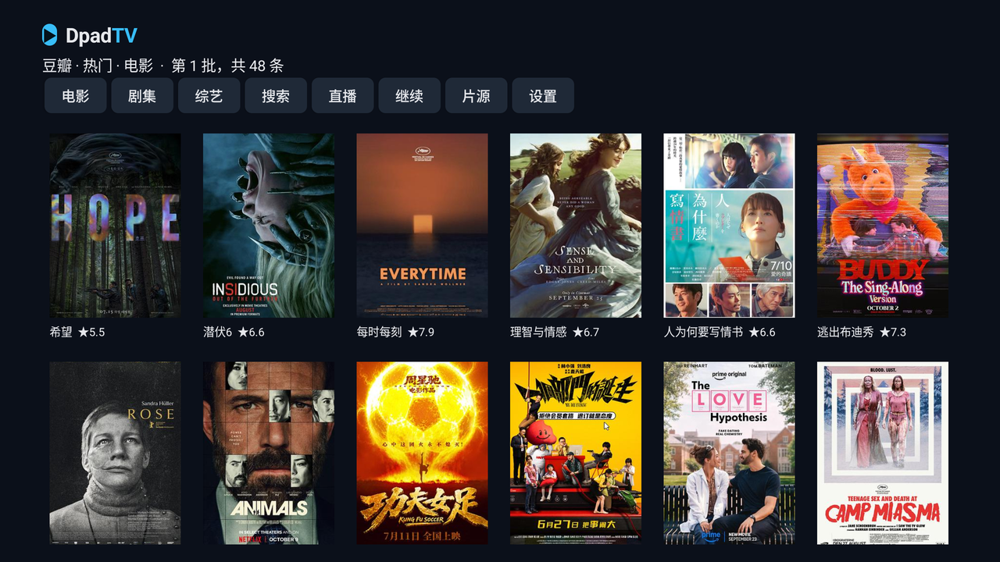
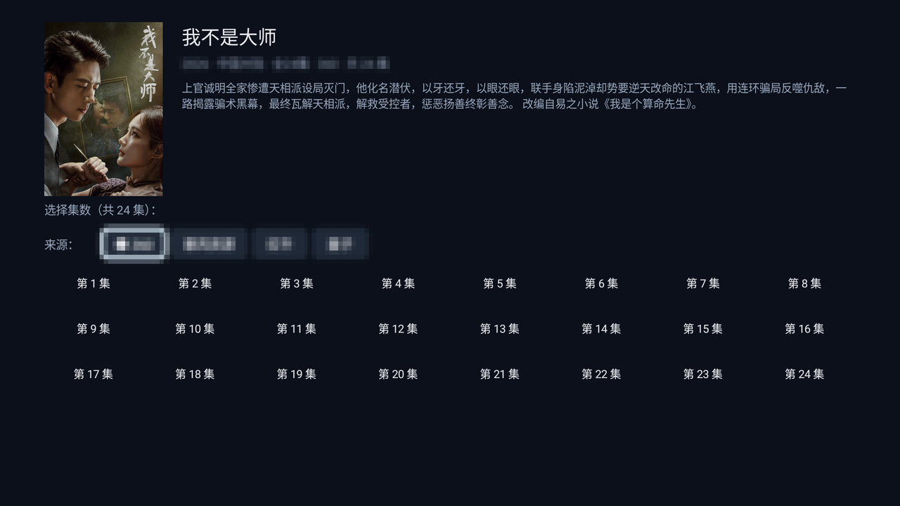
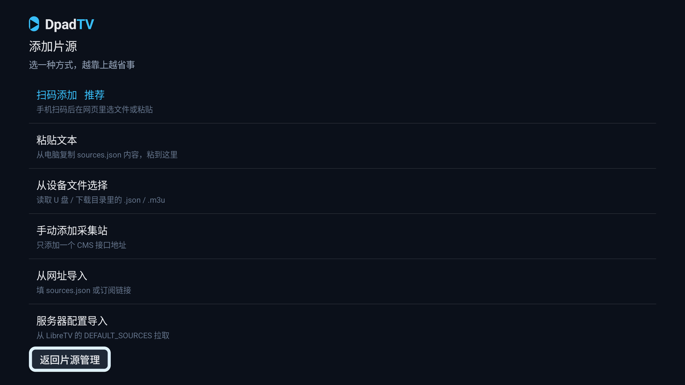
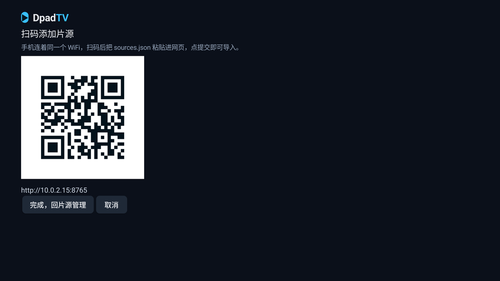

# DpadTV

[LibreTV](https://github.com/LibreSpark/LibreTV) 的 Android TV 客户端 —— 原生实现，不依赖 WebView。

对接你自建的 LibreTV 服务端，在电视上用遥控器浏览、搜索、播放。

> 非官方项目，与 LibreTV 作者无隶属关系。

## 功能

**浏览与搜索**

- **首页**：豆瓣排行榜海报网格，电影 / 剧集 / 综艺三个分类，滚动到底自动加载下一批
- **热门搜索**：搜索页展示三类榜单前 10 名，点一下直接搜
- **搜索**：多源聚合，按片名分组显示来源数，可按来源筛选，记住搜索历史
- **详情**：封面、简介、集数、多来源切换（当前源标 ●）

**片源管理**

- **六种导入方式**：**手机扫码**（可上传文件）/ 粘贴文本 / 设备文件 / 从网址导入 / 手动添加 / 服务器配置
- **单行状态列表**：启用状态、完整地址、连通性结果一目了然
- **全部测试**：一键并发检测所有源，结果持久保存，失效源标红
- **逐条管理**：启用停用（长按一步切换）、改名称地址、上下移动、测试、删除
- **首页按钮可排序、可隐藏**（设置 → 首页按钮排序）

**播放**

- ExoPlayer（Media3）内核，HLS 直连
- **续播**：按播放地址记位置，播过 5 秒起生效，阈值可调
- **自动连播**：整季作为播放列表，一集放完自动进下一集（可关）
- **倍速**：X0.50 ~ X2.00，记住上次选择
- **实时网速**：缓冲时在「缓冲中…」下方显示实际速率
- **进度条三段色**：灰色未缓冲 / 白色已缓冲 / 蓝色已播放
- **磁盘缓存**：分片落盘（默认上限 2 GB，可调 512 MB / 1 GB / 2 GB / 4 GB），回拖与重看不再重复下载
- **解码兜底**：硬解失败自动尝试下一个解码器；也可手动强制软解
- **显示比例**：适应 / 裁切 / 拉伸

**其它**

- **直播**：M3U 多源、按分组筛选
- **继续观看**：本地观看历史（封面 + 进度），缺封面时自动按片名补齐
- **清理缓存**：图片 / 历史 / 搜索记录 / 播放进度 / 磁盘缓存，一次清完
- **更新检测**：启动时检查 GitHub Releases（6 小时内不重复请求）
  - 有新版本时**首页右上角出现胶囊**，按 OK 查看更新说明与下载二维码
  - 设置页页脚同时标红点，可在设置里关闭首页提示
  - 更新说明取自 Release 内容，无需打开浏览器

## 截图

### 首页



### 详情与集数选择



### 添加片源



### 扫码添加片源



## 遥控器操作

**主界面**

| 按键 | 操作 |
|---|---|
| 上下左右 | 移动焦点 |
| OK | 进入 / 执行 |
| 菜单键 | 打开设置 |

**播放页**

| 按键 | 操作 |
|---|---|
| OK | 暂停 / 播放 |
| ← → | 快退 / 快进（短按 10 秒，按住 15 秒连发） |
| ↑ | 倍速菜单 |
| ↓ / 菜单键 | 呼出底部操作栏 |
| 返回 | 退出播放 |

**底部操作栏**：下集 · 上集 · 刷新 · 重播 · 倍速 · 解码 · 比例

## 安装

到 [Releases](../../releases) 下载 APK，拷到电视安装（需允许"未知来源"）。

要求：Android 6.0+，任意 CPU 架构（包内没有原生库）。

## 首次配置

1. 填服务器地址与访问密码，点「连接并登录」
2. 进「片源管理」添加采集站
3. 回首页搜片名

> 片源只支持 Apple CMS **JSON** 接口（`https://xxx/api.php/provide/vod`），`/at/xml/` 这类 XML 通道不支持。

## 构建

```bash
# JDK 17+
echo "sdk.dir=/path/to/android-sdk" > local.properties
./gradlew :app:assembleDebug
```

可选：把默认服务器地址 / 密码写进 `local.properties`（不入库），构建时注入：

```properties
dpadtv.defaultUrl=http://192.168.1.10:8899
dpadtv.defaultPassword=your-password
```

发布包（页脚不带"测试版"字样）：

```bash
./gradlew :app:assembleDebug -Pdpadtv.release=true
```

## 自测（不需要真机）

```bash
node tools/e2e-api.mjs --url http://你的NAS:8899 --password 你的密码
```

复现客户端的调用序列（登录 → 搜索 → 详情 → 播放地址），并**真的拉取 m3u8** 验证地址可播。

## 已知限制

- **H.265 片源**能否播取决于 SoC 硬解，不支持时会明确提示"解码失败"
- 直播只支持 HLS / TS / 渐进式，**FLV 不支持**（ExoPlayer 没有 FLV 解封装器）
- 直播 EPG 未实现
- 观看历史 / 搜索历史都是**本机**的，多设备不同步
- 不预加载下一集（磁盘缓存只缓存已看过的分片）
- 音轨切换、字幕选择尚未做
- 首页顶部按钮栏的左右键已限制在栏内（不会跑到海报区）
- 系统精简掉文件选择器的设备上，「从设备文件选择」可能读不到文件，改用扫码或粘贴

## 支持作者

如果这个客户端帮你省了时间，可以请我喝杯咖啡 —— **不影响任何功能**。

| 微信 | 支付宝 |
|---|---|
|  |  |

## 免责声明

本项目仅为**客户端**，不提供、不存储、不分发任何音视频内容。所有内容均来自用户自行配置的第三方接口。
请自行确认内容来源的合法性，使用者需自行承担相应责任。

## 名称与标识

代码本身遵循 GPL-3.0，修改和再分发都没有附加条件。

只请求一件事：二次发行时换掉应用名称、图标和包名（`com.dpadtv.client`），并注明是非官方版本。
这样别人不会把改动过的版本误认成原版，对项目和你都更省事。

> "DpadTV" 名称与图标本身不随 GPL-3.0 授权。

## 许可

[GNU General Public License v3.0](LICENSE)

可以自由使用、修改、分发；但分发修改后的版本时必须同样以 GPL-3.0 开源，且不能使用本项目的名称与图标（见上方「名称与标识」）。

## 致谢

- [LibreTV](https://github.com/LibreSpark/LibreTV) —— 服务端与接口设计
- [AndroidX Media3](https://github.com/androidx/media) —— 播放器
- [ZXing](https://github.com/zxing/zxing) —— 二维码生成
